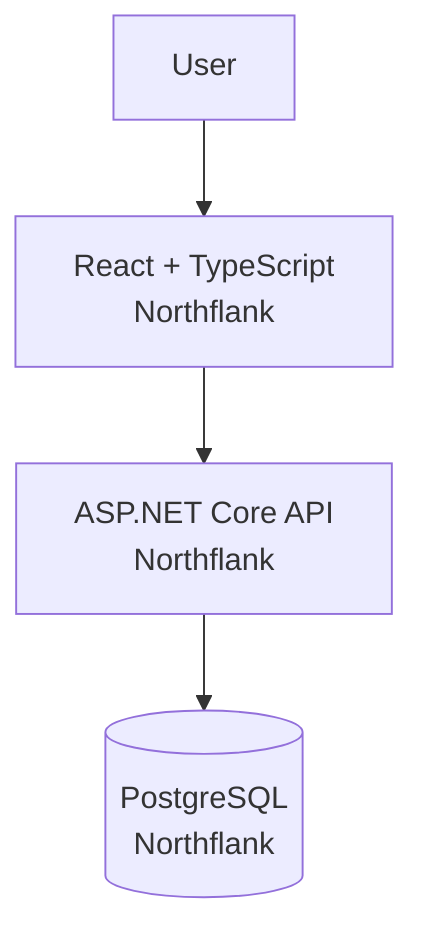

# LOCAL — Community Q&A Platform

A full-stack community Q&A application built with **ASP.NET Core, React, TypeScript, PostgreSQL, and Entity Framework Core**.

The application allows users to ask questions, share responses, and connect with people from their communities based on their country of origin and U.S. state of residence.

## Live Application

**Website:**
https://locals.bio

Users can create accounts, ask questions, and respond to other members of their communities.

---

## Architecture



Production request flow:

```text
locals.bio
        ↓
React + TypeScript
        ↓
/api
        ↓
ASP.NET Core
        ↓
PostgreSQL
```

---

## Tech Stack

### Backend

- C#
- ASP.NET Core
- Entity Framework Core
- LINQ
- PostgreSQL
- REST APIs

### Frontend

- React
- TypeScript
- Vite
- CSS
- Motion for React

### Infrastructure

- Northflank
- Custom domain
- HTTPS
- GitHub CI/CD
- Environment-based configuration
- Automatic deployment

---

## Features

### User Authentication

The backend manages account registration, login, and logout using secure authentication cookies.

Security features include:

- Password hashing
- HttpOnly cookies
- Secure cookies in production
- Rate limiting
- Honeypot bot detection

### Community-Based Questions

Users can create questions associated with a community, residence, and category.

Available categories include:

- Restaurant
- Vivienda
- Emprendimientos

The backend uses visibility rules to restrict questions based on the user's community and residence.

Example:

```text
Peru + New York
        ↓
ASP.NET Core
        ↓
Visibility Rules
        ↓
Questions for Peru + New York
```

### Responses and Pagination

Users can read, publish, and delete their own responses.

The application uses server-side pagination:

- Four questions per page
- Four responses per page

### User Profile

Users can view their community and residence, update their username, and log out.

### Mobile-First Interface

The React application provides:

- Responsive layouts
- Mobile-friendly navigation
- Animated onboarding
- Category filtering

---

## API

### User Authentication

```http
POST /auth/register
POST /auth/login
GET /auth/me
POST /auth/logout
PATCH /auth/username
```

Handles account registration, authentication, logout, and username updates.

### Questions

```http
GET /questions
GET /questions/{id}
POST /questions
DELETE /questions/{id}
```

Retrieves, creates, and deletes questions based on authentication, visibility rules, and ownership.

### Responses

```http
GET /questions/{id}/responses
POST /questions/{id}/responses
DELETE /responses/{id}
```

Retrieves, creates, and deletes responses associated with questions.

### Reference Data

```http
GET /reference-data/communities
GET /reference-data/residences
GET /reference-data/categories
```

Returns the available communities, residences, and question categories.

---

## Database

The application uses PostgreSQL with Entity Framework Core.

Main entities:

```text
User
├── Id
├── Username
├── Email
├── PasswordHash
├── CommunityId
└── ResidenceId
```

```text
Community
├── Id
└── Name
```

```text
Residence
├── Id
├── State
└── Country
```

```text
Category
├── Id
└── Name
```

```text
Question
├── Id
├── UserId
├── CommunityId
├── ResidenceId
├── CategoryId
└── QuestionText
```

```text
Response
├── Id
├── QuestionId
├── UserId
└── Body
```

```text
VisibilityRule
├── SourceCommunityId
├── SourceResidenceId
├── AllowedCommunityId
└── AllowedResidenceId
```

Entity Framework migrations are used to manage schema changes.

Database indexes and optimized LINQ queries support efficient question and response retrieval.

---

## Production Deployment

The frontend, backend, and PostgreSQL database are deployed independently on Northflank.

```text
GitHub
   ↓
Automatic deployment
   ↓
Northflank
   ├── React frontend
   ├── ASP.NET Core backend
   └── PostgreSQL
```

Production configuration includes:

- HTTPS
- Custom domain
- Environment variables
- PostgreSQL connection configuration
- EF Core migrations
- Persistent Data Protection keys
- Automatic redeployment from GitHub

---

## What I Built

This project demonstrates practical experience with:

- Designing REST APIs with ASP.NET Core
- Working with relational databases and Entity Framework Core
- Building React + TypeScript frontends
- Connecting frontend and backend applications
- Implementing authentication and authorization
- Designing community-based data visibility rules
- Optimizing database queries and pagination
- Implementing rate limiting and bot protection
- Managing production configuration
- Deploying a full-stack application
- Using GitHub-based CI/CD

